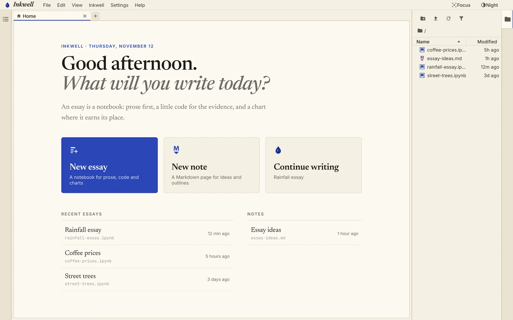
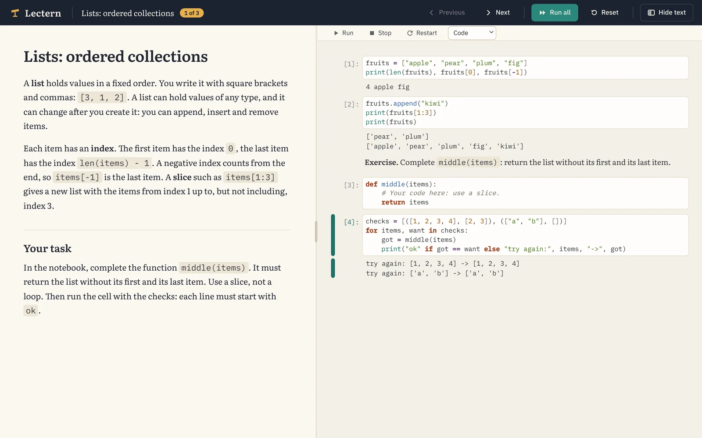
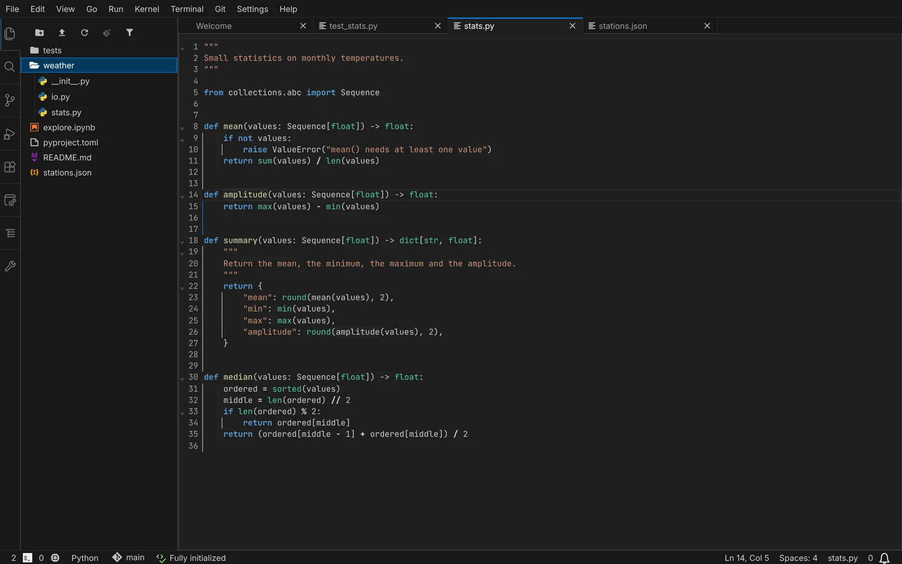

# jupyterlab-skills

Agent skills that let a coding agent customize JupyterLab: disable an
extension, hide a part of the UI, change a default, add a button or a panel,
restyle the application, or turn all of that into a package that anyone can
install.

The skills follow the [Agent Skills](https://agentskills.io) format. They
work in Claude Code, Codex CLI, Gemini CLI, GitHub Copilot, Cursor and other
clients that read `SKILL.md` files.

## What an agent can do with them

| Request | Skill |
| --- | --- |
| "Disable the extension manager", "hide the status bar", "dark theme by default", "move the file browser to the right", "remove the Run menu", "change this shortcut" | `jupyterlab-settings` |
| "Add a button that runs all cells and saves", "add a panel", "replace the launcher with a home page" | `jupyterlab-extensions` |
| "Use these colors and this font", "make it compact" | `jupyterlab-theming` |
| "Make this a package that I can install", "create my own JupyterLab app" | `jupyterlab-distribution` |
| "Build a minimal notebook app from JupyterLab components", "my own shell", "embed a notebook in a page" | `jupyterlab-remix` |
| "What is the ID of this plugin?", "why does my setting not apply?" | `jupyterlab-inspect` |
| "Show me that it works" | `jupyterlab-verify` |
| Any of the above, when the agent does not know where to start | `jupyterlab-customize` |

The work happens in one of two places:

- **In an existing environment.** The agent writes small config files and
  extension folders into the virtual environment (or the user config
  folder). Nothing that a package installed is edited.
- **In a distribution project.** The agent creates a Python project, in the
  style of [xtralab](https://github.com/jtpio/xtralab), whose wheel installs
  JupyterLab with the configuration, the extensions, a launch command and its
  own name.

The two connect: customize an environment, then freeze it into a
distribution with one command.

## The skills

```
skills/
├── jupyterlab-customize/      start here: choose the mechanism, follow the loop
├── jupyterlab-inspect/        folders, IDs of plugins, settings, menus, toolbars, shortcuts
│   └── scripts/jlab_inspect.py
├── jupyterlab-settings/       page config, default overrides, user settings, server config
│   ├── scripts/jlab_config.py
│   └── references/            cookbook, file formats
├── jupyterlab-extensions/     new behavior, with no build step
│   ├── scripts/jlab_ext.py
│   ├── assets/nobuild/        template of the extension file
│   └── references/            patterns, replace core parts, tokens, TypeScript path
├── jupyterlab-theming/        themes, stylesheets, fonts
│   ├── scripts/new_theme.py
│   └── references/            selectors and recipes
├── jupyterlab-distribution/   one pip-installable package for everything
│   └── scripts/jlab_dist.py
├── jupyterlab-remix/          a new application from JupyterLab packages, with its own bundle
│   ├── scripts/jlab_remix.py
│   ├── assets/                project templates
│   └── references/            the server class, the custom shell
└── jupyterlab-verify/         headless browser proof and screenshots
    └── scripts/jlab_server.py, jlab_probe.cjs
```

How they fit together:

1. **Inspect**: find the folders and the exact IDs. A wrong ID fails
   silently in JupyterLab.
2. **Change**: the weakest mechanism that does the job. A setting, then a
   disabled plugin, then a stylesheet, then an extension.
3. **Verify**: start a throwaway server with a clean profile, probe it in
   headless Chromium, read the screenshot.
4. **Package** (optional): build a wheel, install it in a clean environment,
   verify again.

Design choices:

- **Scripts check before they write.** `jlab_config.py` refuses a setting
  key that the schema does not have and a value of the wrong type. It adds
  the plugins that depend on a disabled plugin, so that the browser console
  stays clean.
- **Extensions need no build.** The default path is one plain JavaScript
  file that takes `@jupyterlab/*`, `@lumino/*` and React from the running
  application. No Node.js, no `node_modules`. A TypeScript path is documented
  for extensions that need npm packages.
- **Themes start complete.** `new_theme.py` copies a built-in theme and adds
  a file for the overrides, because a theme that defines only some variables
  breaks the interface.
- **No copies of version data.** The skills have no lists of plugins,
  commands, shortcuts or CSS variables. `jlab_inspect.py` reads them from
  the installation, and the probe reads them from the running application,
  so they are correct for each version and include the installed extensions.
- **No copy of the documentation.** The skills hold the procedure, the
  traps, tested snippets and the scripts. For the meaning of a feature they
  link to the JupyterLab documentation.
  [docs/upstream-doc-gaps.md](docs/upstream-doc-gaps.md) lists the facts
  that the skills must still hold because the documentation does not have
  them.
- **Everything was run.** The recipes and code patterns were executed
  against JupyterLab 4.6.6. `tools/check_recipes.py` checks them for a new
  version.

## Examples

Three applications that a coding agent built with these skills and a product
brief, with no other source of JupyterLab knowledge.

| Example | Kind | What it shows |
| --- | --- | --- |
| [`examples/inkwell`](examples/inkwell) | Distribution: JupyterLab with configuration, a theme and no-build extensions | A writing studio: a home page in place of the launcher, its own themes and fonts, new commands, a shorter menu bar and toolbar. No build step |
| [`examples/lectern`](examples/lectern) | Remix: a new application from JupyterLab packages, with its own shell | A two-pane lesson reader: the text of a lesson on the left, its notebook on the right. Its own bundle and server class |
| [`examples/meridian`](examples/meridian) | Distribution: JupyterLab with published extensions as dependencies, configuration, themes and no-build extensions | A desktop code editor look: activity bar, Explorer tree, panel with the terminal, command palette at the top, Quick Open, language server, Git, search across files. No build step |







## Install

### Claude Code

```bash
claude plugin marketplace add jtpio/jupyterlab-skills
```

```bash
claude plugin install jupyterlab-skills@jupyterlab-skills
```

To try it without an install:

```bash
git clone https://github.com/jtpio/jupyterlab-skills.git
```

```bash
claude --plugin-dir ./jupyterlab-skills
```

### Any client that reads Agent Skills

```bash
npx skills add jtpio/jupyterlab-skills
```

Or copy the folders:

```bash
git clone --depth=1 https://github.com/jtpio/jupyterlab-skills.git /tmp/jupyterlab-skills
```

```bash
mkdir -p ~/.agents/skills && cp -r /tmp/jupyterlab-skills/skills/* ~/.agents/skills/
```

Claude Code also reads `~/.claude/skills/`, Codex CLI `~/.codex/skills/`.
For one project only, copy the folders to `.agents/skills/` (or
`.claude/skills/`) in the repository.

Install the eight skills together. Each one has its own scripts, but they
refer to each other by name.

## Requirements

- JupyterLab 4.x. The recipes were made with 4.6.
- Python 3.9 or newer. `jlab_inspect.py` and `jlab_config.py` must run with
  the Python of the environment that has JupyterLab.
- For `jupyterlab-verify`: Node.js with [Playwright](https://playwright.dev)
  and Chromium.
- For `jupyterlab-distribution`: [uv](https://docs.astral.sh/uv/) or the
  `build` package.

## Try it

In a project with a virtual environment that has JupyterLab, ask the agent:

- "Hide the status bar and the extension manager in my JupyterLab, and make
  the dark theme the default."
- "Add a button to the notebook toolbar that clears all outputs and saves."
- "Create a JupyterLab distribution named `quiet-lab`: no launcher, a home
  page with my recent notebooks, a warm light theme, and only the File, Edit
  and Help menus. Build the wheel and show me a screenshot."

## Use the scripts without an agent

The scripts are plain command-line tools:

```bash
.venv/bin/python skills/jupyterlab-inspect/scripts/jlab_inspect.py find "line numbers"
```

```bash
.venv/bin/python skills/jupyterlab-settings/scripts/jlab_config.py set @jupyterlab/notebook-extension:tracker codeCellConfig '{"lineNumbers": true}'
```

```bash
python skills/jupyterlab-verify/scripts/jlab_server.py start --python .venv/bin/python --root-dir /tmp/demo
```

```bash
node skills/jupyterlab-verify/scripts/jlab_probe.cjs --screenshot lab.png --fail-on-console-error
```

```bash
python skills/jupyterlab-verify/scripts/jlab_server.py stop
```

## Maintain

After a new JupyterLab release, check the recipes: `tools/check_recipes.py`
validates each JSON block of a Markdown file against an installation.

```bash
<env>/bin/python tools/check_recipes.py skills/jupyterlab-settings/references/recipes.md skills/jupyterlab-settings/SKILL.md
```

One file of data is a copy: `core_plugins.json` (in the settings and remix
skills) holds the service that each core plugin provides and requires. The
files of an installation do not have this data. `jlab_config.py` gives a
warning when the installed JupyterLab is a different minor version, and it
accepts fresh data (`--graph`). To update the copy:

```bash
python skills/jupyterlab-verify/scripts/jlab_server.py start --python <env>/bin/python --root-dir /tmp/stock
```

```bash
node skills/jupyterlab-verify/scripts/jlab_probe.cjs --dump /tmp/stock.json
```

```bash
python tools/update_plugin_data.py /tmp/stock.json
```

When a fact of [docs/upstream-doc-gaps.md](docs/upstream-doc-gaps.md) lands
in the JupyterLab documentation, replace the text in the skill with a link.

The module federation container (the last part of `remoteEntry.js`) exists
in three places: `skills/jupyterlab-extensions/assets/nobuild/remoteEntry.js`,
`skills/jupyterlab-theming/scripts/new_theme.py` and
`skills/jupyterlab-distribution/scripts/jlab_dist.py`. Keep them the same.

## License

BSD-3-Clause
