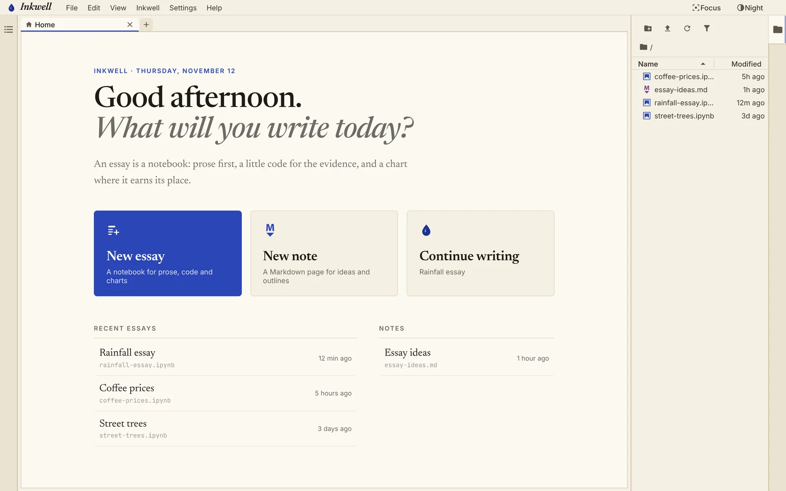
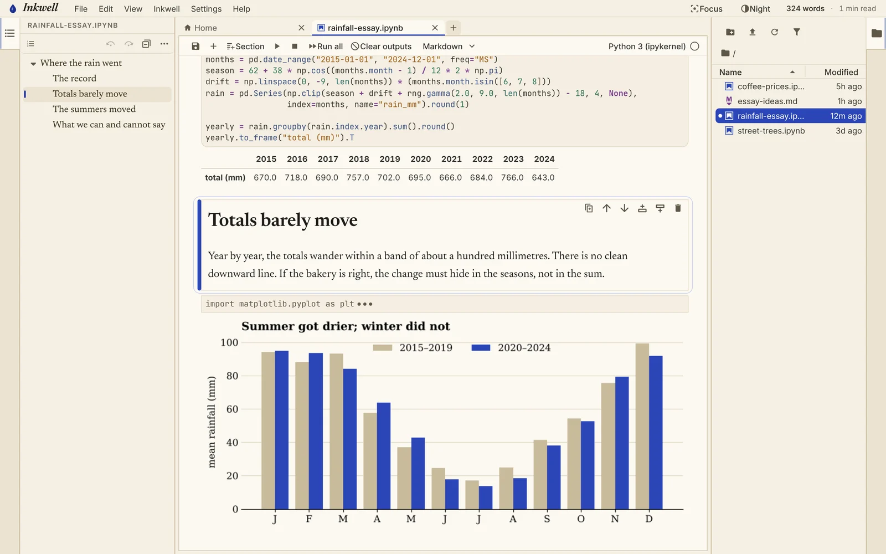

# Inkwell

A calm notebook studio for data essays, built on JupyterLab. Inkwell is an
example of a JupyterLab distribution: one Python package that installs
JupyterLab with its own configuration, extensions, themes and launch command.





## Where it comes from

A coding agent built Inkwell as a test of the skills in this repository. It
got the skills and a product brief, and no other source of JupyterLab
knowledge. The project is the output of that run, with two additions: this
README and the `demo/` folder. It shows what the skills produce; it is not a
maintained product.

Nothing here needs a build step. There is no Node.js, no TypeScript and no
`node_modules`.

## Run it

From this folder, with an environment that has JupyterLab 4.6 or newer (and
`matplotlib` and `pandas` for the demo notebooks):

```bash
uv build --wheel
```

```bash
uvx --from dist/inkwell_lab-0.1.0-py3-none-any.whl inkwell demo
```

Or run the project with no install, through the verify script of the skills:

```bash
python ../../skills/jupyterlab-verify/scripts/jlab_server.py start --name inkwell --python <env>/bin/python --project . --root-dir demo
```

```bash
python ../../skills/jupyterlab-verify/scripts/jlab_server.py url --name inkwell
```

```bash
python ../../skills/jupyterlab-verify/scripts/jlab_server.py stop --name inkwell
```

Install the wheel in its own environment: the configuration applies to each
JupyterLab that starts from the same environment.

## What is different from JupyterLab, and where it is done

| Change | Mechanism | File |
| --- | --- | --- |
| Name "Inkwell" in the browser tab | Page config `appName` | `jupyter-config/labconfig/page_config.d/inkwell-lab.json` |
| No extension manager, debugger, property inspector, running tab, news prompt, Jupyter logo | Disabled plugins | same file |
| No status bar; no Run, Kernel and Tabs menus; an Inkwell menu; a shorter notebook toolbar; outline on the left, files on the right; autosave each 30 s; line wrap; Markdown as the default cell type | Default setting overrides | `jupyter-config/labconfig/default_setting_overrides.d/inkwell-lab.json` |
| `Accel K` opens the command palette, `Accel Shift Enter` runs all cells, `Accel Alt S` inserts a section, `Accel Alt F` toggles focus mode | Shortcut overrides | same file |
| Themes "Inkwell Paper" and "Inkwell Night" with bundled fonts | Theme extension | `labextensions/inkwell-theme/` |
| Home page in place of the launcher, brand, favicon, splash screen, About dialog | Plugins that replace core plugins | `labextensions/inkwell-lab/static/remoteEntry.js` |
| Commands Insert Section, Toggle Focus Mode, theme toggle; live word count | New plugins | same file |
| Command `inkwell`, with its own user settings and workspaces | Launch command | `inkwell_lab/cli.py` |

The core extension `inkwell-lab` has seven plugins: `home`, `brand`,
`favicon`, `about`, `splash`, `commands` and `word-count`. Its
`package.json` names the four core plugins that it replaces.

## Layout

```
inkwell/
├── pyproject.toml                     shared-data: the two folders below go to sys.prefix
├── inkwell_lab/cli.py                 the `inkwell` command
├── jupyter-config/                    → etc/jupyter/
│   └── labconfig/
│       ├── page_config.d/inkwell-lab.json
│       └── default_setting_overrides.d/inkwell-lab.json
├── labextensions/                     → share/jupyter/labextensions/
│   ├── inkwell-lab/                   core extension: one JavaScript file, one stylesheet
│   └── inkwell-theme/                 two themes, shared rules in common.css, fonts
├── demo/                              sample notebooks, not in the wheel
└── screenshots/                       not in the wheel
```

## Fonts

The theme bundles Newsreader, Inter and JetBrains Mono as `.woff2` files,
from the `@fontsource` packages. All three use the SIL Open Font License; the
license texts are next to the files in
`labextensions/inkwell-theme/themes/inkwell-theme/fonts/`.

## Known defects

The agent reported these and did not correct them:

- The splash screen has the light colors also when the dark theme is active.
- Focus mode is not kept after a page reload.
- The word count is approximate.
- Insert Section does not put the new heading cell in edit mode.
- The Help menu entry "About Inkwell" comes from a menu override, because the
  core extension has no settings schema. A project that `jlab_dist.py new`
  creates today has a schema for that.
