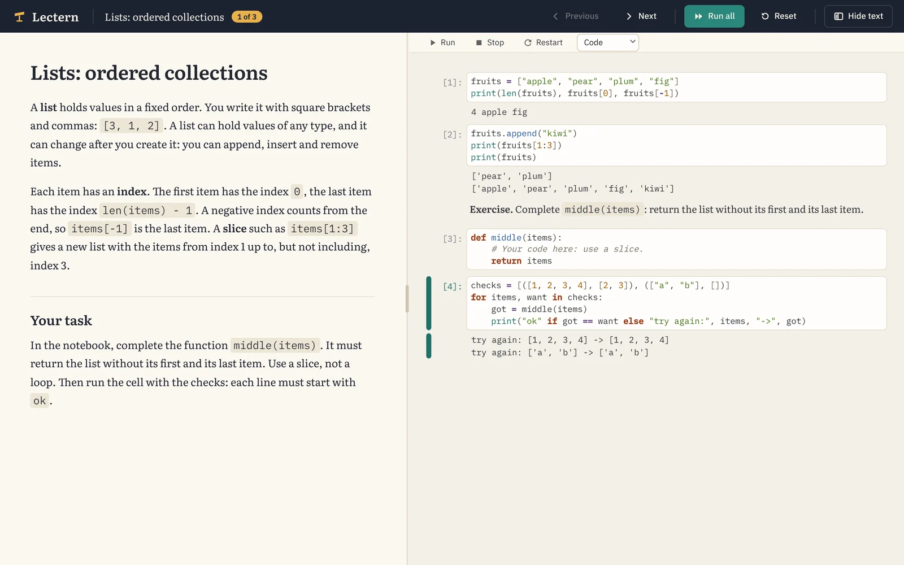
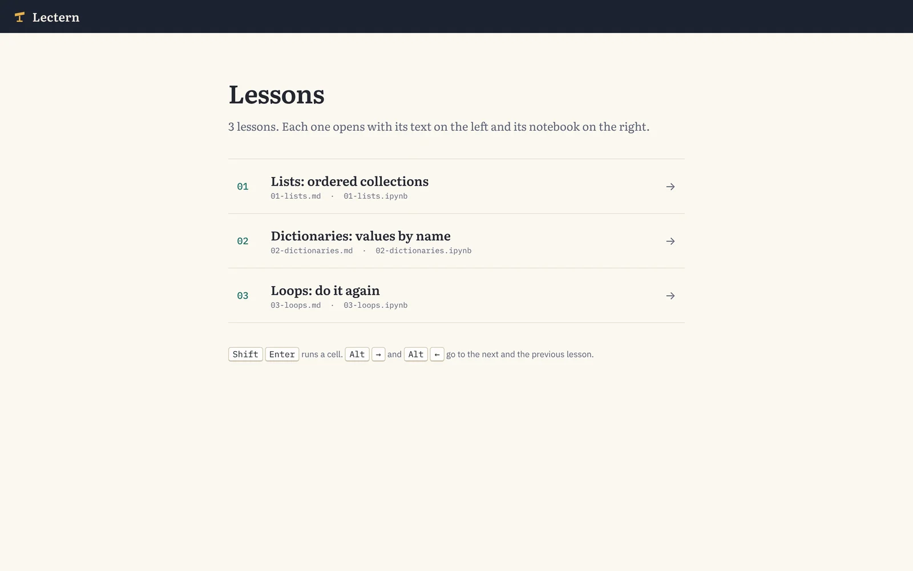

# Lectern



Lectern is a two-pane lesson reader for teaching with notebooks. The text of a
lesson (Markdown, read-only) shows on the left, its notebook (editable,
runnable) on the right, with a divider that you can drag. It is a separate web
application built from JupyterLab npm packages: it has its own bundle, its own
shell and its own server class. It does not use the installed JupyterLab.

## Where it comes from

A coding agent built Lectern as a test of the skill `jupyterlab-remix` of
this repository. It got the skills and a product brief, and no other source
of JupyterLab knowledge. The project is the output of that run, with three
additions: this section, the `lessons/` and `screenshots/` folders, and the
full list of package versions in `package.json` (`overrides`). It shows what
the skill produces; it is not a maintained product.



## Lessons

A lesson is a pair of files in the folder that the server shows:

```
01-lists.md         the text: its first heading is the title of the lesson
01-lists.ipynb      the notebook
```

- `/lectern` shows the lessons in the order of their number.
- `/lectern/lessons/01-lists` opens one lesson.
- A lesson with only one of the two files opens with a note in the other pane.

Top bar: Previous, Next, Run all, Reset, Hide text. **Reset** clears the
outputs and execution counts of all cells (`notebook:clear-all-cell-outputs`).
It does not change the code, does not restart the kernel and does not save.

Keys: `Shift Enter` runs a cell, `Alt →` and `Alt ←` go to the next and the
previous lesson.

When you leave a lesson, Lectern saves its notebook (if it changed) and
closes it, which also stops its kernel.

## Build and run

Needs Node.js 20 or newer, Python 3.9 or newer and uv.

```bash
npm install
npm run build:prod
uv build --wheel
```

```bash
uv venv .venv && uv pip install --python .venv/bin/python dist/lectern-0.1.0-py3-none-any.whl
.venv/bin/lectern --ServerApp.root_dir=lessons
```

The wheel contains the bundle: the target machine needs no Node.js. During
development, `npm run build` (with source maps) and an editable install
(`uv pip install -e .`) are faster; restart the server after each build.

The folder `lessons/` has three sample lessons. They are not in the wheel.

## Layout of the project

```
package.json                 npm packages; "jupyterlab.extensions" lists the
                             packages whose schemas, themes and CSS the build copies
rspack.config.js             the bundle
src/index.js                 picks the core plugins, registers them and ours
src/app.js                   the application class
src/shell.js                 the shell: top bar, start page, text | notebook split
src/lessons.js               finds the lessons of a folder and their titles
src/icons.js                 the icons of the top bar
src/tokens.js                the ILessonReader token
src/plugins/paths.js         provides JupyterFrontEnd.IPaths
src/plugins/reader.js        routes, start page, text pane, notebook pane, navigation
src/plugins/top.js           brand, lesson title and position, buttons
style/app.css                the look: palette, fonts, layout
lectern/app.py               the server class (URL /lectern, /lectern/lessons/...)
lectern/settings/overrides.json   default settings: notebook toolbar, shortcuts,
                             kernel shutdown on close
lectern/static, schemas, themes   written by the build (not in git)
```

## From the template, and what is new

The project started from the kind `shell` template of the `jupyterlab-remix`
skill (`jlab_remix.py new lectern --kind shell`).

Kept from the template: the build setup (`package.json`, `rspack.config.js`,
`pyproject.toml`), the application class (`src/app.js`), the selection of 25
core plugins with `pick()` in `src/index.js`, the `paths` plugin, the server
class and the page template.

New:

- The shell has two more areas: `home` (start page) and `text` (left pane),
  and a Lumino `SplitPanel` between the text and the notebook (`main`). It
  keeps the width of the text pane when the pane hides and shows again.
- `reader.js` replaces the template `opener.js`: lesson routes, start page,
  rendered Markdown with the rendermime registry, notebook per lesson,
  Previous/Next.
- `top.js` is rewritten: lesson title and position, grouped buttons, own
  commands `lectern:run-all`, `lectern:reset`, `lectern:toggle-text`.
- Settings overrides: the notebook toolbar keeps only Run, Stop (interrupt),
  Restart and the cell type; `Alt ArrowRight`/`Alt ArrowLeft` call
  `lectern:next`/`lectern:previous`; a closed notebook stops its kernel.
- The look: CSS variables of JupyterLab and own rules on top of the light
  theme, fonts from npm (`@fontsource`: Literata, IBM Plex Sans, IBM Plex
  Mono, SIL Open Font License).

## Known limits

The agent reported these and did not correct them:

- The width of the text pane is not kept after a page reload.
- Lectern saves a changed notebook when you leave a lesson, so the edits of
  a student change the files of the lessons folder. Reset does not restore
  the original code.
- A link from the text of one lesson to another `.md` file opens the raw
  file, not the lesson.
- There is no kernel busy indicator, no dark theme, and no warning for
  unsaved changes when the page closes.
