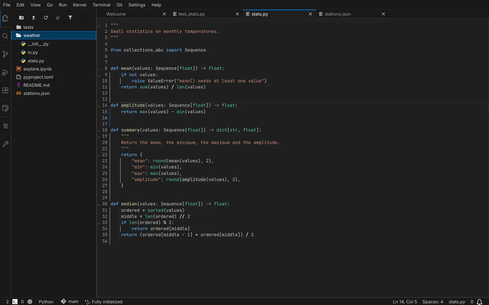
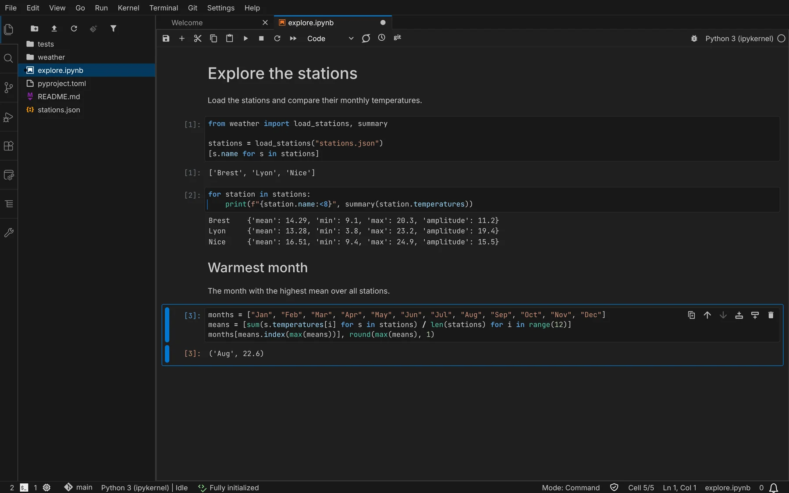
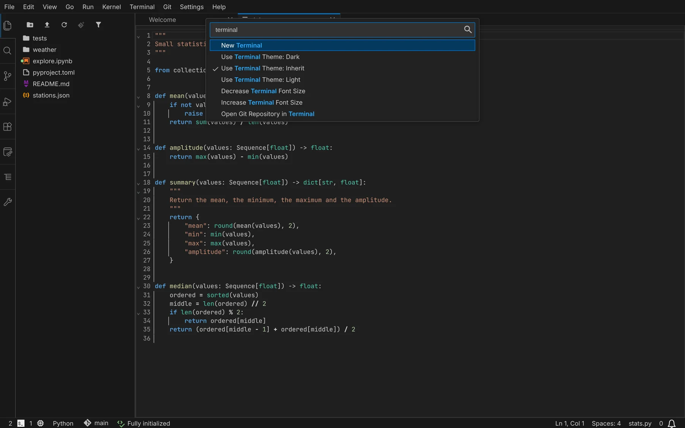
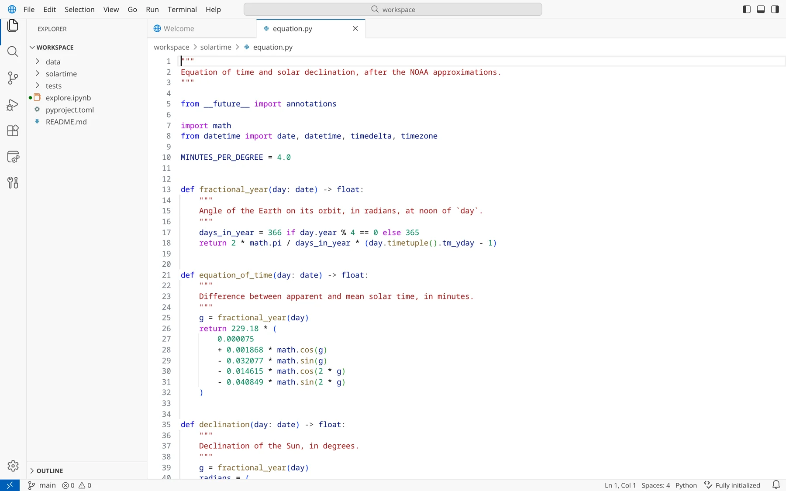

# Meridian

Meridian is JupyterLab with the look and the keys of a desktop code editor:
a dark theme whose colors follow the default dark theme of Visual Studio
Code, an activity bar, editor tabs, a terminal panel below the editors and
the familiar shortcuts. It stays JupyterLab: notebooks, the file browser,
dialogs, the settings editor and all JupyterLab extensions work as usual.

Meridian is a JupyterLab distribution, not a fork: one Python package that
brings JupyterLab 4.6, configuration files, two small extensions with no
build step, and published extensions as dependencies.






| | |
| --- | --- |
|  |  |
|  |  |



## Where it comes from

A coding agent built Meridian as a test of the skills in this repository. It
got the skills and a product brief. It could not see this repository, the
other examples or any earlier work. The brief asked for a new application
from a small amount of work: configuration, a theme and published
extensions, with little code, and a result that stays close to JupyterLab.
The agent worked for 55 minutes.

The project is the output of that run, with these additions: the `demo/`
folder (the workspace that the agent made for its checks), the smoke test in
`tests/`, the notice file of the icons, the sections of this README that
show the pictures and describe the run and the test, and the version number
0.2.0. The code of the application is as the agent wrote it. It shows what
the skills produce; it is not a maintained product.

## Build and run

```bash
uv build --wheel
```

```bash
uv venv .venv && uv pip install --python .venv/bin/python dist/meridian_lab-0.2.0-py3-none-any.whl
```

```bash
.venv/bin/meridian --notebook-dir /path/to/project
```

Or build and start it on the demo folder with one command:

```bash
uv build --wheel && uvx --from dist/meridian_lab-0.2.0-py3-none-any.whl meridian demo
```

The Git view needs `git`, and the search across files needs `rg` (ripgrep)
on the `PATH`. The `demo/` folder is not a Git repository: run `git init` in
a copy of it to see the Git view with content.

All `jupyter lab` options work. Install Meridian in its own environment:
its configuration applies to every JupyterLab that starts from that
environment. The `meridian` command keeps its user settings in
`~/.jupyter/meridian-lab/`, apart from those of a plain JupyterLab.

## Keys

| Keys | Action |
| --- | --- |
| Ctrl+Shift+P, F1 | Command palette |
| Ctrl+P | Quick Open |
| Ctrl+B | Show or hide the side bar |
| Ctrl+J | Show or hide the panel |
| Ctrl+\` | Show, focus or hide the terminal of the panel |
| Ctrl+Shift+\` | New terminal |
| Ctrl+Shift+E / F / G / X | File browser / Search / Git / Extensions |
| Ctrl+, | Settings |
| F12 | Go to definition |
| Shift+Alt+F | Format the file or the notebook |

The other JupyterLab shortcuts stay. In a terminal, the keys above F12 go
to Meridian, not to the shell.

## Layout of the project

```
meridian-lab/
├── pyproject.toml                  package, dependencies, `meridian` command
├── meridian_lab/cli.py             the `meridian` command
├── jupyter-config/labconfig/       → <prefix>/etc/jupyter/labconfig/
│   ├── page_config.d/meridian-lab.json               name, no logo
│   └── default_setting_overrides.d/meridian-lab.json theme, layout, menus, keys
└── labextensions/                  → <prefix>/share/jupyter/labextensions/
    ├── meridian-lab/               Welcome tab, terminal toggle, panel size
    │   ├── package.json            replaces the launcher
    │   ├── schemas/                Ctrl+` and the Help menu entry
    │   └── static/                 remoteEntry.js, style.css
    └── meridian-theme/             the themes Meridian Dark and Meridian Light
        ├── static/remoteEntry.js   registers the two themes
        └── themes/meridian-theme/  CSS, fonts, icons, licenses
```

In this repository, the folder also has `demo/` (a small Python project to
open) and `tests/smoke.cjs`.

The configuration does most of the work: all views in the left side bar,
terminals in the panel below the editors, the shortcuts, the menus "Go" and
"Terminal", JSON files in the text editor, ruff as the formatter. The theme
gives the colors, the fonts and the icons of the activity bar. The only code
is in `labextensions/meridian-lab/static/remoteEntry.js`: the Welcome tab,
the Ctrl+\` command, the keys that skip the shell, and a correction for the
size of the panel when it is hidden and shown again.

## Smoke test

`tests/smoke.cjs` starts Meridian on a copy of `demo/` and uses it as a
person does, in a real browser: Quick Open, the command palette, each view
of the side bar, a terminal, two editors side by side, a notebook with Run
All, the search, the Git view, the settings, the Welcome tab and the two
themes. It drags each divider with the mouse and compares the sizes, hides
and shows the side bar and the panel two times, moves a view to the other
side bar, makes the window smaller, and reads the browser console. It has 47
checks. It needs Node.js and Playwright
(`npm install --no-save playwright`, then `npx playwright install chromium`).

```bash
node tests/smoke.cjs --meridian .venv/bin/meridian
```

To watch the test in a browser window, add `--headed 1 --slow 400`.

One console message of stock JupyterLab 4.6 is in the list `KNOWN_ERRORS`
of the test: "Close All Tabs" stops a kernel while the debugger asks for its
state.

## Extensions

| Package | Gives |
| --- | --- |
| `jupyterlab-lsp`, `python-lsp-server`, `python-lsp-ruff` | Completion, hover, diagnostics, go to definition, rename |
| `jupyterlab-quickopen` | Quick Open of files (Ctrl+P) |
| `jupyterlab-git` | Git view, diffs, Git menu |
| `jupyterlab-search-replace` | Search and replace in all files (Ctrl+Shift+F) |
| `jupyterlab-unfold` | Tree view in the file browser |
| `jupyterlab-code-formatter`, `ruff` | Format files and notebooks |
| `jupyterlab-indent-guides` | Indentation guides in the editors |

## Bundled assets and licenses

| Asset | Source | License |
| --- | --- | --- |
| Inter (UI font) | npm `@fontsource-variable/inter` 5.3.0 | SIL Open Font License 1.1 |
| JetBrains Mono (code font) | npm `@fontsource-variable/jetbrains-mono` 5.3.0 | SIL Open Font License 1.1 |
| Codicons (icons of the activity bar) | npm `@vscode/codicons` 0.0.46-24 | CC BY 4.0, © Microsoft Corporation |

The license texts are in `labextensions/meridian-theme/themes/meridian-theme/licenses/`.
The icons are used without change. Meridian is not affiliated with
Microsoft or with Visual Studio Code.
