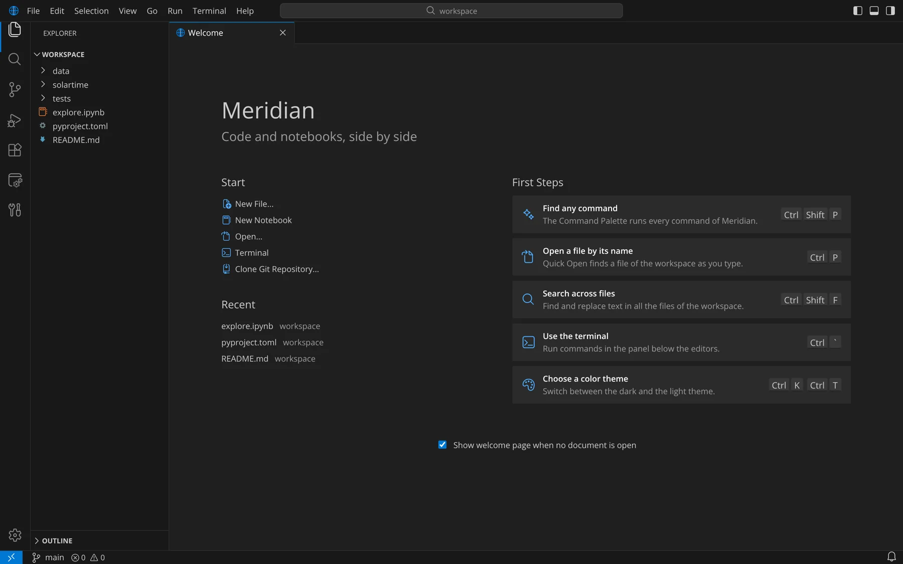
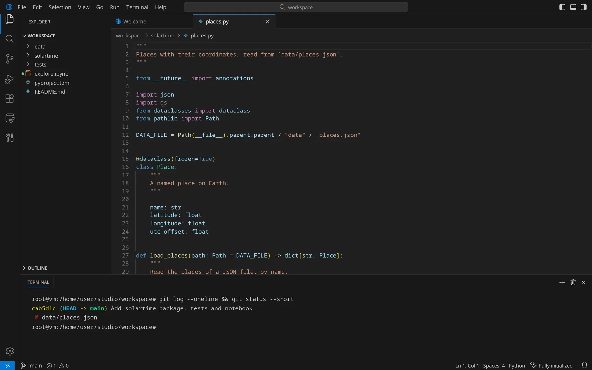
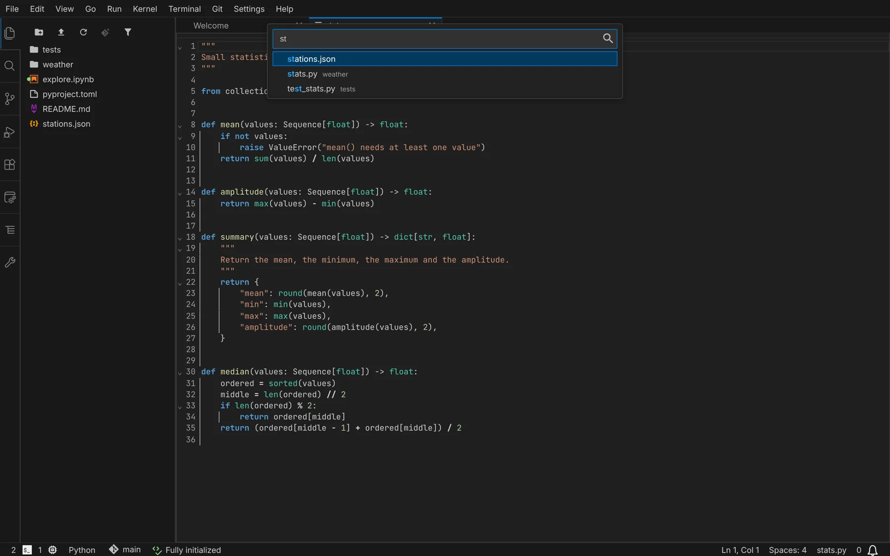
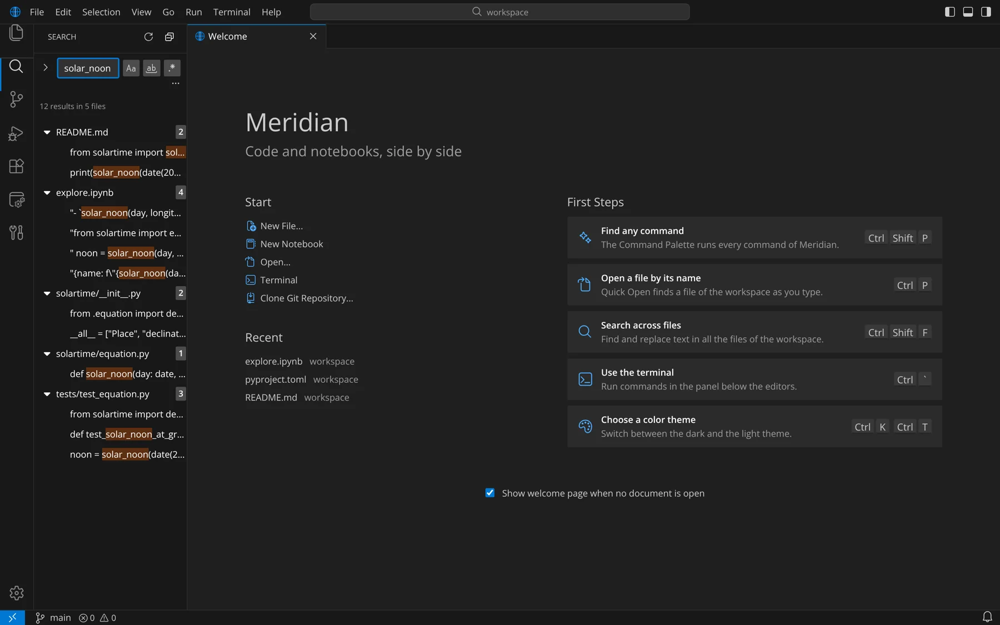

# Meridian

Meridian is JupyterLab arranged, themed and keyed like a desktop code editor.
Its layout, colors and keyboard shortcuts follow Visual Studio Code, so that a
person who knows that editor feels at home at once.

Meridian is an example of a JupyterLab **distribution**, not a new
application: one Python package installs JupyterLab 4.6, a set of existing
extensions, configuration files and five small extensions without a build
step. Every other JupyterLab extension installs and loads as usual.






| | |
| --- | --- |
|  |  |
|  |  |

## Where it comes from

A coding agent built Meridian as a test of the skills in this repository. It
got the skills and a product brief. It could not see this repository, the
other examples or any earlier work. The project is the output of that run,
with two additions: this README (the agent wrote most of it) and the `demo/`
folder, which is the workspace that the agent made for its checks. It shows
what the skills produce; it is not a maintained product.

The brief asked the agent to reuse published extensions and to write code
only for what no extension gives. Nothing here needs a build step. There is
no Node.js, no TypeScript and no `node_modules`.

## Run it

From this folder:

```bash
uv build --wheel
```

```bash
uvx --from dist/meridian_lab-0.1.0-py3-none-any.whl meridian demo
```

Install the wheel in its own environment: the configuration applies to each
JupyterLab that starts from the same environment. The `meridian` command
keeps its settings apart from those of a plain JupyterLab
(`~/.jupyter/meridian-lab/`). All `jupyter lab` options work, for example
`meridian --no-browser --port 9000`.

The Git view needs `git`, and the search across files needs `rg`
([ripgrep](https://github.com/BurntSushi/ripgrep)) on the `PATH`. The `demo/`
folder is not a Git repository: run `git init` in a copy of it to see the
Source Control view with content.

## What it changes

| Part | How |
| --- | --- |
| Activity bar, side bar views with titles in capitals, Explorer with the Outline as a section | `meridian-lab` extension and layout settings |
| Editor tabs, panel below the editors for the terminal, status bar | Settings, `meridian-lab` extension and theme rules |
| Menus File, Edit, Selection, View, Go, Run, Terminal, Help | Menu settings |
| Keys: Ctrl+Shift+P and F1, Ctrl+P, Ctrl+B, Ctrl+J, Ctrl+\`, Ctrl+Shift+E/F/G/X, Ctrl+, and Ctrl+K Ctrl+T | Shortcut settings and commands of `meridian-lab` |
| Dark and light themes, editor token colors, notebook cell gutter | `meridian-theme` and `meridian-editor` extensions |
| Icons of the interface and of the file types | `meridian-icons` extension |
| Welcome page in place of the launcher | `meridian-welcome` extension |

## Extensions it depends on

These are dependencies in `pyproject.toml`. Meridian does not copy their code.

| Package | Gives |
| --- | --- |
| `jupyterlab-lsp`, `python-lsp-server`, `python-lsp-ruff` | Completion, hover, diagnostics, go to definition, rename (language server) |
| `jupyterlab-quickopen` | Quick Open of files (Ctrl+P) |
| `jupyterlab-git` | Source Control view, branch in the status bar |
| `jupyterlab-search-replace` | Search and replace across files (Ctrl+Shift+F) |
| `jupyterlab-unfold` | Explorer as a tree |
| `jupyterlab-code-formatter`, `ruff` | Format Document (Shift+Alt+F) |
| `jupyterlab-indent-guides` | Indentation guides |
| `jupyterlab-rainbow-brackets` | Colored bracket pairs |
| `jupyterlab-highlight-selected-word` | Highlight of the other occurrences of the selection |
| `jupyterlab-expand-selection` | Expand and shrink the selection (Shift+Alt+Right/Left) |
| `lckr-jupyterlab-variableinspector` | Variables view of the kernel, in the panel |
| `jupyterlab-execute-time` | Duration of each cell run, below the cell |

## Layout

```
meridian/
├── pyproject.toml                  package, dependencies, the `meridian` command
├── meridian_lab/cli.py             the `meridian` command
├── jupyter-config/labconfig/       → etc/jupyter/labconfig
│   ├── page_config.d/meridian-lab.json               application name
│   └── default_setting_overrides.d/meridian-lab.json theme, layout, menus,
│                                                     toolbars, shortcuts
├── labextensions/                  → share/jupyter/labextensions
│   ├── meridian-lab/               views, panel, title bar, status bar, pickers,
│   │                               splash screen, About dialog, favicon
│   ├── meridian-welcome/           Welcome page (replaces the launcher)
│   ├── meridian-editor/            editor theme, notebook cell gutter
│   ├── meridian-icons/             Codicons and Seti icons
│   └── meridian-theme/             themes "Meridian Dark" and "Meridian Light", fonts
└── demo/                           a small Python project to open
```

## Known limits

- Palette items have no category prefix, Quick Open shows no file icons, and
  the editor has no minimap.
- Run and Debug is the kernel debugger of JupyterLab, with no launch
  configurations.
- In a normal browser tab, the browser keeps some keys (Ctrl+T, Ctrl+W,
  Ctrl+N). The color theme picker is also in File > Preferences.
- Some code uses private APIs of JupyterLab and xterm.js. For this reason,
  the package pins JupyterLab to `>=4.6.6,<4.7`.
- The terminals use the DOM renderer of xterm.js. The setting "Terminal GPU
  Acceleration" of Meridian turns the WebGL renderer back on.
- `jupyterlab-search-replace` and `lckr-jupyterlab-variableinspector` show a
  version warning in `jupyter labextension list`. They load and work.

## Third-party assets

- Icons of the interface: [Codicons](https://github.com/microsoft/vscode-codicons)
  (npm package `@vscode/codicons` 0.0.46), Creative Commons Attribution 4.0
  International (CC BY 4.0). The SVG files are unmodified. See
  `labextensions/meridian-icons/static/codicons/LICENSE`.
- File icons: [Seti UI](https://github.com/jesseweed/seti-ui) icons from the
  npm package `seti-icons` 0.0.4, MIT License. See
  `labextensions/meridian-icons/static/seti/LICENSE`.
- Fonts: Open Sans and Noto Sans Mono (npm packages
  `@fontsource-variable/open-sans` and `@fontsource-variable/noto-sans-mono`),
  SIL Open Font License 1.1. See `labextensions/meridian-theme/themes/meridian-theme/fonts/`.

Meridian is not affiliated with Microsoft. The licenses of these assets do not
give rights to the names or logos of their authors.
